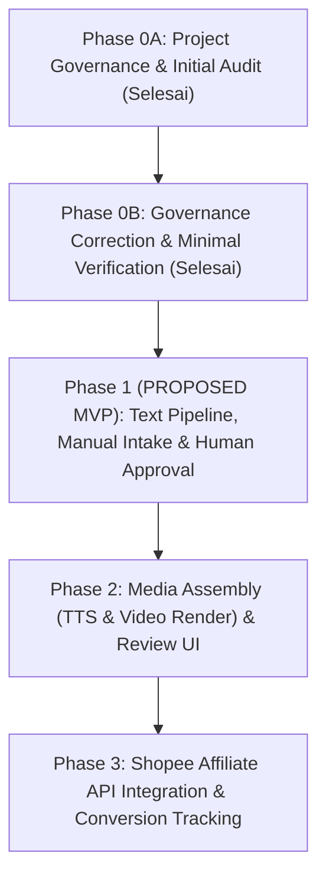

# IMPLEMENTATION ROADMAP: AI AFFILIATE CONTENT FACTORY

> **Status Dokumen:** `PROPOSAL` (Usulan rencana bertahap, menunggu persetujuan formal pengguna).

Dokumen ini memetakan tahapan pengembangan sistem mulai dari koreksi tata kelola, verifikasi minimal, MVP berorientasi teks dan kurasi manusia, hingga otomasi media dan analitik.

---

## Ringkasan Alur Pengembangan

---

## Phase 0A: Project Governance & Initial Audit (Selesai)
- Menetapkan piagam proyek, batasan operasional, inventaris repositori awal, dan analisis hardware Windows.
- Menghasilkan dokumen tata kelola persisten dan skill `Project Guardian & Verification`.

---

## Phase 0B: Governance Correction & Minimal Verification (Selesai)
- **Aktivitas yang Telah Selesai:**
  1. Koreksi status keputusan (menghilangkan klaim `APPROVED`/`REJECTED` tanpa persetujuan pengguna).
  2. Pengecekan Git: verifikasi bahwa direktori belum berupa repo Git (tidak menjalankan `git init`).
  3. Pembuatan virtual environment Python 3.12 via `uv` (`.venv`).
  4. Instalasi dan uji validasi model `pydantic 2.14.2` (`exit code 0`).
  5. Uji FFmpeg sintetis: verifikasi keberhasilan CPU encoding `libx264` (`1.64 detik`) dan kegagalan GPU `h264_nvenc` akibat ketidakcocokan driver NVIDIA (`581.32` vs `610.00+`).
  6. Audit resmi Shopee Indonesia: pembedaan Shopee Open Platform vs Affiliate Open API (GraphQL), aturan disclosure konten AI di Shopee Video, dan larangan pencurian konten/re-upload.
- **Kriteria Kelulusan:**
  - [x] Dokumen registri dan keputusan arsitektur dikoreksi sesuai bukti empiris.
  - [x] Smoke test minimal Pydantic dan FFmpeg tercatat dengan exit code aktual di `VERIFICATION_LOG.md`.
  - [x] Tidak ada paket tambahan yang diinstal selain Pydantic.

---

## Phase 1: Core Content MVP (Usulan Tahap Berikutnya — PROPOSAL)

Tujuan utama Phase 1 adalah menghasilkan naskah promosi yang terstruktur, akurat, patuh etika, dan siap digunakan secara manual tanpa risiko pemblokiran platform atau pemborosan sumber daya komputasi.

### Komponen & Langkah Kerja MVP:
1. **Input Produk Manual:**
   - Formulir/JSON terstruktur untuk memasukkan data produk pilihan (nama, link afiliasi bertag sub-ID, harga, poin keunggulan, kategori, dan target persona).
2. **Penyimpanan Data Produk & Sumber:**
   - Menyimpan data produk dan tautan sumber aset ke database SQLite lokal atau file JSON terstruktur berbasis Pydantic.
3. **Generasi Draft Teks:**
   - Modul AI Copywriter menghasilkan variasi naskah pendek (Hook 0-3 detik, Problem/Benefit 3-12 detik, Call to Action 12-15 detik), saran caption, dan rekomendasi hashtag.
4. **Pemeriksaan Klaim & Disclosure:**
   - Pengecekan otomatis/aturan terhadap klaim berlebihan (misal: klaim medis tanpa bukti) dan penambahan label disclosure wajib (sesuai aturan transparansi afiliasi & kebijakan AI Shopee Video).
5. **Human Approval Gate:**
   - Alur berhenti pada status `WAITING_APPROVAL`. Pengguna memeriksa, mengedit, dan memberikan keputusan (`APPROVE`, `REVISE`, atau `REJECT`).
6. **Paket Konten untuk Distribusi Manual:**
   - Mengekspor paket siap posting (teks naskah, copy caption, link afiliasi terverifikasi, dan panduan visual) ke folder output lokal agar pengguna dapat mendistribusikannya secara manual.
7. **Pencatatan Hasil Manual:**
   - Menyediakan skema pencatatan evaluasi performa per konten (tanggal posting, jumlah tayangan, klik link, jumlah pesanan, estimasi komisi, dan sumber data) untuk mengukur efektivitas hook.

### Komponen yang DITUNDA dari Phase 1 (`DEFERRED`):
- **Otomasi Text-to-Speech (TTS):** Ditunda sampai kualitas draft naskah terbukti memuaskan pengguna.
- **Render Video Otomatis:** Ditunda sampai format naskah dan aset visual tervalidasi.
- **Web Scraping Otomatis:** Ditunda karena risiko blokir IP Shopee dan pelanggaran ToS.
- **Auto-Publishing / Posting Bot:** Ditunda demi keselamatan akun dan kepatuhan platform.

### Kriteria Kelulusan Phase 1:
- [ ] 1 produk yang diinput manual berhasil menghasilkan 3 variasi draft teks terstruktur.
- [ ] Kontrak Pydantic tervalidasi 100% tanpa error data.
- [ ] Tersedia gerbang human approval sebelum paket konten diekspor.
- [ ] Data performa manual dapat dicatat dan disimpan ke SQLite.

---

## Phase 2: Media Assembly & Review Dashboard (PROPOSAL)
- **Tujuan:** Menambahkan modul audio voiceover (Edge-TTS / local TTS) dan perakitan video otomatis (FFmpeg `libx264`) untuk draft yang telah disetujui, serta dashboard web 2D lokal sederhana untuk review.
- **Komponen:**
  1. Modul audio voiceover bahasa Indonesia terisolasi.
  2. Modul perakitan klip 9:16 vertikal via template FFmpeg `libx264`.
  3. Dashboard lokal (FastAPI + HTML/SSE) untuk memantau status antrean dan melakukan approve/reject via browser.

---

## Phase 3: Analytics & Official API Integration (PROPOSAL)
- **Tujuan:** Mengintegrasikan Shopee Affiliate Open API resmi dan evaluasi performa berbasis data.
- **Komponen:**
  1. Klien GraphQL untuk Shopee Affiliate Open API (`generateShortLink` & `productOfferV2`) jika kredensial `AppId` dan `Secret` telah tersedia.
  2. Sinkronisasi laporan konversi dan komisi otomatis.
  3. Analisis korelasi performa konten terhadap formulasi hook copywriting.
